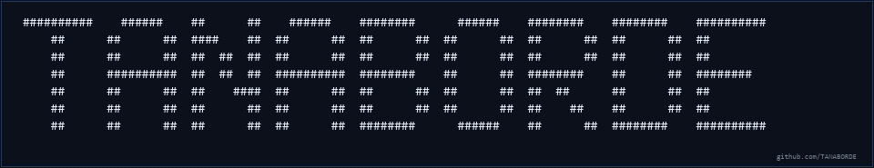

<!--
GitHub profile README for https://github.com/TANABORDE
Place this file and terminal-banner.gif at the root of the public TANABORDE/TANABORDE repository.
The visual cards below use public image services; all essential profile details remain readable as text.
-->

<div align="center">
  <a href="https://github.com/TANABORDE">
    
  </a>
  <p><strong>Game developer &amp; game designer</strong> based in Bangkok, Thailand.</p>
  <p>
    <a href="https://github.com/TANABORDE/math-snake">Featured project</a>
    ·
    <a href="https://github.com/TANABORDE?tab=repositories">Repositories</a>
    ·
    <a href="https://github.com/TANABORDE">GitHub profile</a>
  </p>
  <p>
    
    
    
    
  </p>
</div>

## 01 · About

I'm TANABORDE, a game developer and game designer based in Bangkok, Thailand. I design games and build interactive prototypes.

```text
tanaborde@github:~$ whoami
TANABORDE · Game Dev / Game Design

tanaborde@github:~$ location
Bangkok, Thailand

tanaborde@github:~$ ls public-projects
math-snake
```
## 02 · Profile signal

<div align="center">
  <a href="https://github.com/TANABORDE">
    
  </a>
</div>

[View activity directly on GitHub](https://github.com/TANABORDE?tab=overview)
